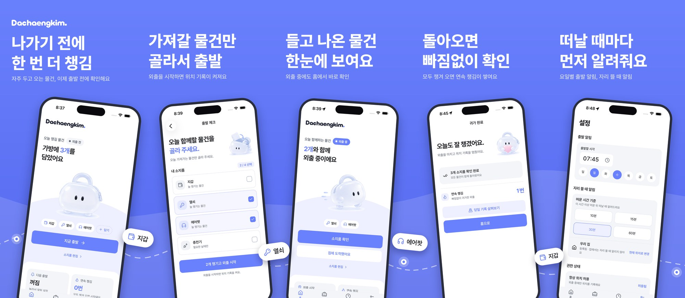
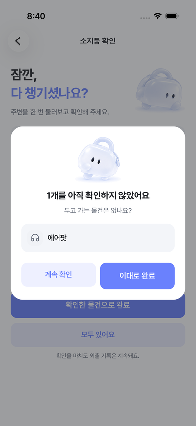
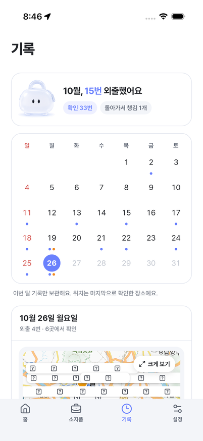
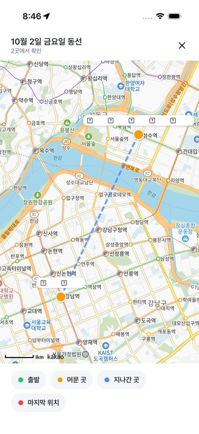
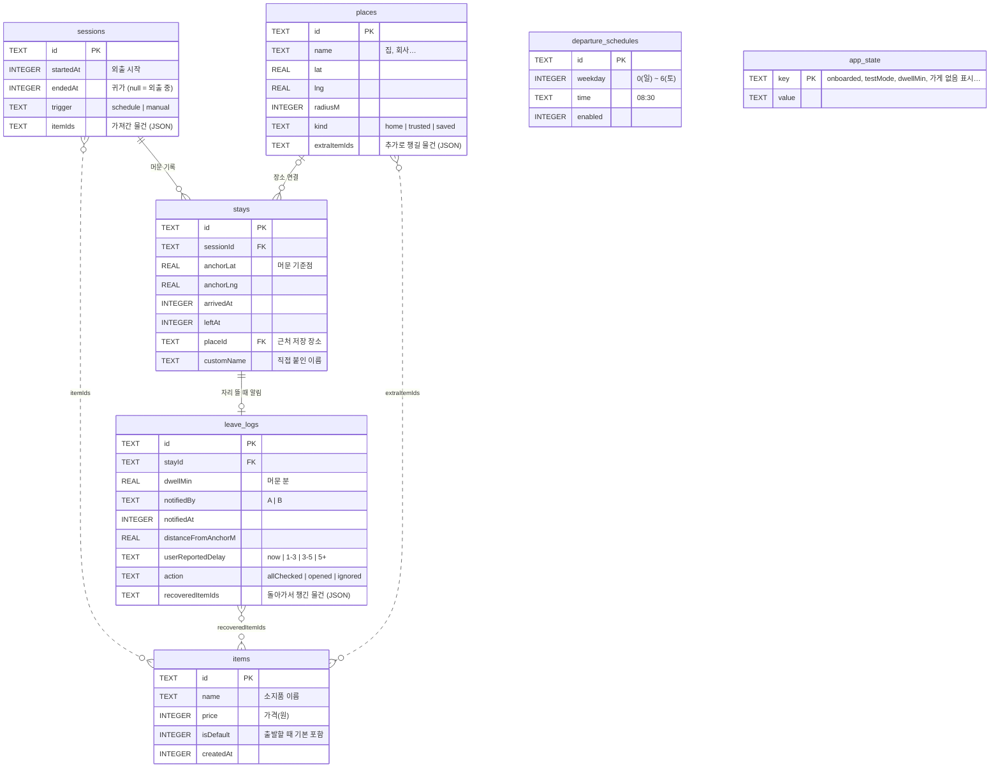
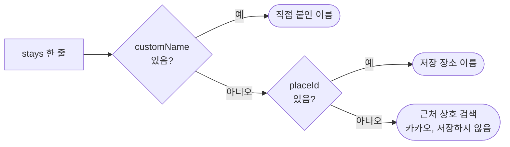

<div align="center">

### 잊기 쉬운 순간에, 한 번 더 챙김.

출발할 때, 자리를 떠날 때, 집에 돌아왔을 때.<br>
물건을 두고 오기 쉬운 순간에만 짧게 확인하는 소지품 앱입니다.


</div>

<br>



---

## 이런 적 있나요?

카페에서 일어나 한참 걷다가 "아, 이어폰." 학원을 나서고 나서야 떠오르는 충전기.
물건을 잃어버리는 건 대부분 **자리를 뜨는 그 순간**입니다.

챙김은 하루 종일 알림을 보내지 않습니다. 놓치기 쉬운 세 번의 순간에만 가방이 먼저 물어봐요.

<br>

## 세 번의 순간

<table>
  <tr>
    <td width="120" align="center"></td>
    <td>
      <h3>1. 출발할 때</h3>
      정해 둔 요일과 시각에 출발 알림이 와요.<br>
      늘 챙기는 물건은 미리 담겨 있고, 오늘 더 가져갈 물건만 골라 가방에 담으면 끝.
    </td>
  </tr>
  <tr>
    <td align="center"></td>
    <td>
      <h3>2. 자리를 떠날 때</h3>
      카페, 학원, 도서관처럼 한동안 머문 곳을 떠나는 순간 <b>"두고 가는 물건은 없나요?"</b><br>
      알림에서 바로 <b>✅ 모두 챙김</b>을 누르거나, 앱에서 물건을 하나씩 확인해요.<br>
      얼마나 머문 뒤 알릴지는 10·15·30·60분 중에서 고를 수 있어요. 집은 자동으로 빠져요.
    </td>
  </tr>
  <tr>
    <td align="center"></td>
    <td>
      <h3>3. 집에 돌아왔을 때</h3>
      집에 도착하면 마지막으로 모두 함께 왔는지 확인해요.<br>
      빠뜨린 물건이 있으면 돌아가서 챙긴 뒤 기록으로 남길 수 있어요.
    </td>
  </tr>
</table>

<p align="center">
  
  
  
</p>

<br>

## 그리고 기록

<table>
  <tr>
    <td width="120" align="center"></td>
    <td>
      <h3>하루가 지도로 남아요</h3>
      이번 달 외출을 캘린더로 보여줘요. 외출한 날은 파란 점, 빠뜨린 날은 주황 점.<br>
      날짜를 누르면 그날 머문 곳과 동선 지도, 어디서 무엇을 확인했는지 볼 수 있어요.
    </td>
  </tr>
  <tr>
    <td align="center"></td>
    <td>
      <h3>연속 챙김</h3>
      모두 챙겨서 귀가한 외출이 몇 번 이어졌는지 세어 줘요. 끊기지 않게 이어 가 보세요.
    </td>
  </tr>
  <tr>
    <td align="center"></td>
    <td>
      <h3>위치는 외출 중에만</h3>
      외출을 시작하면 위치 기록을 켜고, 귀가를 마치면 멈춰요.<br>
      기록은 기기 안에만 저장되고, 이번 달 기록만 남겨요.<br>
      챙김은 물건 자체를 감지하지 않아요. 두고 오기 쉬운 순간을 알려 주고, 확인은 직접 해요.
    </td>
  </tr>
</table>

<br>

---


## 개발

Expo(React Native)로 만든 iOS 앱입니다. 화면 흐름은 Maestro로, 배포는 EAS로 합니다.

| 영역 | 사용한 것 |
| --- | --- |
| 앱 | Expo SDK 58, React Native 0.88, Expo Router |
| 위치 | `expo-location` 백그라운드 위치 + `expo-task-manager` (머문 곳 감지와 자리 뜰 때 알림) |
| 알림 | `expo-notifications` (알림에서 바로 "모두 챙김" 응답) |
| 저장 | `expo-sqlite` (기기 안 파일 하나, 서버 없음) |
| 지도와 장소 | 카카오맵 JavaScript SDK(WebView), 카카오 로컬 API(근처 상호 이름) |
| 테스트 | Maestro 화면 시나리오 13개 (`.maestro/flows`) |
| 배포 | EAS Build, EAS Update(OTA) |

### 실행하기

백그라운드 위치와 알림 액션을 쓰기 때문에 Expo Go가 아니라 개발 빌드가 필요합니다.

```bash
npm install
npx expo run:ios
```

프로젝트 루트에 `.env.local`을 만들고 카카오 앱 키 두 개를 넣습니다.

```
EXPO_PUBLIC_KAKAO_JS_KEY=   # 지도 (카카오 콘솔에 JavaScript SDK 도메인 등록 필요)
EXPO_PUBLIC_KAKAO_REST_KEY= # 근처 상호 검색
```

키가 없어도 앱은 동작합니다. 지도는 "불러오지 못했어요"로, 장소 이름은 기기의 주소로 대신 보여줍니다.

### 테스트

```bash
npx tsc --noEmit
npx expo lint
maestro test .maestro/flows   # iOS 시뮬레이터, 빌드 전 필수
```

### 저장 구조

모든 데이터는 기기 안의 SQLite 파일 `chaengkim.db` 하나에 저장됩니다.



### 외출 한 번의 흐름


### 머문 곳 이름 정하는 순서


